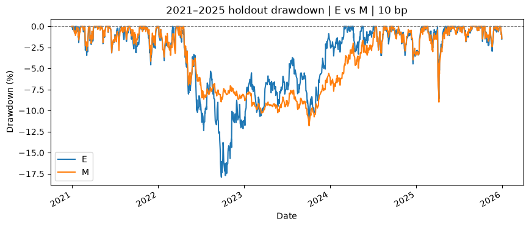

# 跨资产 ETF 策略研究助手

一个可以安装在 Codex 中的 Skill。给它一组美国上市、美元计价的 ETF 和一段历史区间，它会比较**每月恢复等权**与**按过去 12 个月的涨幅决定是否持有**。两组使用相同行情、交易时点和费用。结果先回答谁赚得更多、从前高到低点谁跌得更少，以及各自多久回到前高。

[下载 Skill ZIP](./cross-asset-etf-research.zip?raw=1) · [安装说明](docs/installation.md) · [六只 ETF 历史案例](docs/case-study.md)

## 六只 ETF 的研究发现

用 **DBC、EFA、GLD、IEF、SPY、VNQ** 比较两种策略。收益以美元计，买入和卖出各按成交金额收 **0.10%**。

| 历史区间 | 等权年化收益 | 动量年化收益 | 等权最大回撤 | 动量最大回撤 |
| --- | ---: | ---: | ---: | ---: |
| 2008–2015 开发期 | 2.99% | 4.62% | −39.93% | −13.11% |
| 2016–2020 验证期 | 8.51% | 0.77% | −22.58% | −18.46% |
| 2021–2025 最终历史留出期 | 9.66% | 7.49% | −17.91% | −11.80% |

在最终历史留出期，动量组的最大回撤浅了 **6.11 个百分点**，年化收益也低了 **2.17 个百分点**。图中蓝线是等权组（E），橙线是动量组（M），0% 表示组合处在当时的净值高点。

[查看策略细节、三段历史的全套指标和回撤恢复日期](docs/case-study.md)

## 快速开始

先[安装 Skill 和回测环境](docs/installation.md)，然后在 Codex 中打开含有该 Skill 的项目。

### 1. 跑合成示例

把下面的请求发给 Codex。

> 用 $cross-asset-etf-research 跑合成示例。告诉我哪组年化收益更高、哪组从高点跌得更少、两组是否恢复前高，并给我结果表的位置。

安装完成后，这个示例无需下载行情。它会生成三只虚构 ETF 的价格和结果表。以下为 **2023–2024 年合成数据**在每边 0.10% 费率下的示例输出。

| 策略 | 扣费后年化收益 | 最大回撤 | 恢复情况 |
| --- | ---: | ---: | --- |
| 等权 | 2.53% | −17.05% | 截至期末未恢复 |
| 动量 | 7.49% | −9.49% | 截至期末未恢复 |

### 2. 比较真实历史行情

> 用 $cross-asset-etf-research 比较 SPY、IEF、GLD 在 2016–2020 年的表现。使用公开日频复权行情，每月调仓，买卖各收成交金额的 0.10%。告诉我哪组赚得更多、跌得更少、多久回到前高，并保存行情快照。

> 用同一次回测保存的行情，把买入和卖出的费率都改成 0.25%。和 0.10% 并列比较两组的年化收益、最大回撤和恢复时间，先告诉我原来的判断有没有改变。

真实行情示例使用 **Yahoo Finance 美元日频复权收盘价**。以下结果来自 2026 年 11 月 12 日保存的快照，实际回测覆盖 2016-01-04 至 2020-12-31。提高费率后，等权组年化收益仍较高、恢复仍较快，两组最大回撤仍相当。

| 每边费率 | 策略 | 扣费后年化收益 | 最大回撤 | 触底到恢复 | 见顶到恢复 |
| --- | --- | ---: | ---: | ---: | ---: |
| 0.10% | 等权 | 10.98% | −12.67% | 41 天 | 68 天 |
| 0.10% | 动量 | 5.65% | −12.67% | 111 天 | 138 天 |
| 0.25% | 等权 | 10.90% | −12.67% | 41 天 | 68 天 |
| 0.25% | 动量 | 5.40% | −12.67% | 111 天 | 138 天 |

新下载的行情可能因数据供应商修订而出现差异。

## 策略和数据

- **等权组**每月把每只 ETF 调回 `1/N`。**动量组**只给过去 12 个月涨幅严格大于零的 ETF 保留 `1/N`，其他份额留在零息现金里。信号使用月末复权收盘价，下一个共同交易日收盘时执行。
- 用户提供可核验来源的复权行情 CSV 时优先使用该文件，否则从 Yahoo Finance 获取。若数据缺失，Skill 会说明缺口。若全部标的仍能在原定结束月份前完成有效比较，它会给出最早候选起始月份，等用户确认后再跑。
- 主表展示每边 **0.10%** 的结果。费用对照用每边 **0%、0.05%、0.10%、0.20%** 检查年化收益排名。恢复时间用自然日计，从触底和从见顶各算一次。
- 每次比较会记录实际日期、价格来源、费率和文件指纹。只改费率时使用上一次保存的行情。历史结果用来解释给定规则在过去区间内的取舍，回答范围限于历史研究。

代码采用 [MIT 许可](LICENSE)。仓库公开研究摘要、图表以及可运行的合成示例。原始行情和完整日度价格表由研究者保存在本地。
