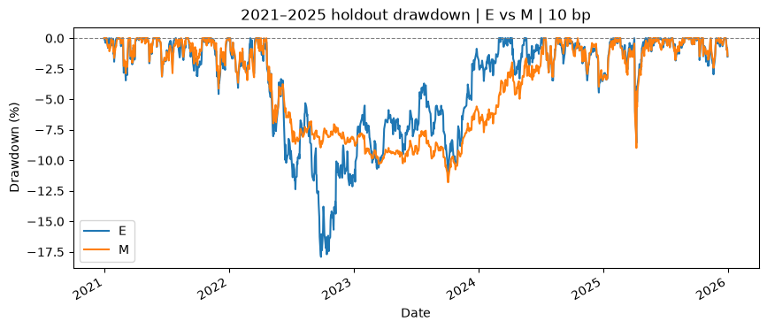

# 六只 ETF 的历史研究

研究用 **DBC、EFA、GLD、IEF、SPY、VNQ** 比较月度等权和 12 个月绝对动量。两组采用相同的美元日频复权收盘价、交易日期和费用规则。

## 每月如何调仓

- **等权组（E）**每月把六只 ETF 各调回六分之一。
- **动量组（M）**用月末复权收盘价除以 12 个月前的月末复权收盘价，再减去 1。涨幅严格大于零的 ETF 获得原来的六分之一份额，其余份额留在不计息的现金里。
- 在信号生成后的第一个交易日收盘调仓。旧持仓承担截至执行收盘的价格变动，新持仓从执行收盘之后的收益区间开始计入。买入和卖出各按 ETF 成交金额的 **0.10%** 收费。

回测从现金起步，连续运行 2008–2025 年。2016 年和 2021 年进入新阶段时延续此前的持仓，并以新阶段前一个交易日的净值为起点计算该阶段指标。2021–2025 年作为最终历史留出期。

## 收益和风险

| 历史区间 | 策略 | 累计收益 | 年化收益 | 年化波动率 | 最大回撤 |
| --- | --- | ---: | ---: | ---: | ---: |
| 2008–2015 开发期 | 等权 | 26.60% | 2.99% | 15.63% | −39.93% |
| 2008–2015 开发期 | 动量 | 43.45% | 4.62% | 8.49% | −13.11% |
| 2016–2020 验证期 | 等权 | 50.46% | 8.51% | 10.64% | −22.58% |
| 2016–2020 验证期 | 动量 | 3.92% | 0.77% | 7.76% | −18.46% |
| 2021–2025 最终历史留出期 | 等权 | 58.54% | 9.66% | 10.49% | −17.91% |
| 2021–2025 最终历史留出期 | 动量 | 43.46% | 7.49% | 7.79% | −11.80% |

收益以美元计，全部指标基于扣除买卖费用后的净值。动量组三段的最大回撤均较浅、波动率均较低。动量组在开发期的年化收益更高，在验证期和最终历史留出期的年化收益更低。买卖每边费率设为 **0%、0.05%、0.10% 或 0.20%** 时，各阶段内的收益排名都一致。

## 最终历史留出期的回撤和恢复

最大回撤描述净值从此前高点到低点最多跌了多少。两组以各自的高点计算回撤和恢复。净值触底后首次达到或超过原高点的日期是恢复日，时长为自然日。

| 策略 | 高点 | 低点 | 恢复日 | 触底到恢复 | 见顶到恢复 |
| --- | --- | --- | --- | ---: | ---: |
| 等权 | 2022-03-30 | 2022-09-27 | 2024-03-01 | 521 天 | 702 天 |
| 动量 | 2022-04-20 | 2023-10-04 | 2024-07-11 | 281 天 | 813 天 |

动量组的最大回撤较浅，触底后恢复也更快。它从见顶到恢复用了 813 天，比等权组多 111 天。

## 行情来源和适用范围

原研究使用 2026 年 10 月 23 日通过 yfinance 获取的 Yahoo Finance 快照，覆盖 2006 年 12 月至 2025 年 12 月，每只 ETF 共有 4,800 个观测交易日。调整后的价格用于计算收益，包含供应商对拆分和分配的调整。结论取决于这六只标的、所选区间、复权价格、调仓约定和零息现金假设。供应商可能修订历史数据。
